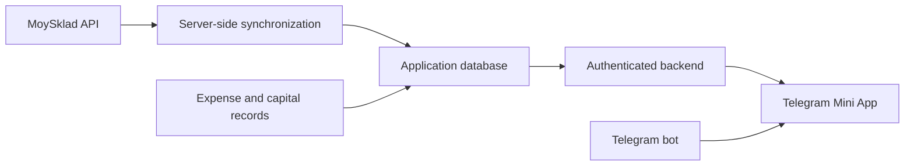

# MoySklad Telegram Dashboard Demo

A public Agent2s lesson case: build a Telegram bot and Mini App that explain inventory turnover and return on capital using MoySklad data.

**Status:** research and proposed scope. No application, live integration, imported account data or deployment exists yet.

## The business question

Where is the owner's money, which products are tying it up, and how much profit does the business generate on the original investment?

Proposed fictional business: a home-goods retailer selling mugs, containers and organizers, with 30 products, two warehouses and 180 days of synthetic history.

Starting scenario: RUB 10 million invested, RUB 7 million of inventory at cost, RUB 3 million cash. These are illustrative figures, not account data.

## Read the case

- [MoySklad data map](docs/moysklad-data-map.md)
- [Financial methodology and sample reconciliation](docs/financial-methodology.md)
- [Delivery stages and proposed screens](docs/project-outline.md)
- [Synthetic worked example](demo/scenario.json)

## Intended data flow

MoySklad is the source of inventory documents and reports. The application will calculate owner-facing indicators and show the source and reporting period for each number.

## Proposed screens

1. Capital: inventory at cost, cash, original investment and profit.
2. Turnover: sales at cost, average inventory and days of inventory.
3. Slow stock: positive stock without recent sales, with an explicit threshold.
4. Profit: revenue, cost of goods sold, expenses and return on the original investment.

## Public demo boundaries

- Only fictional products, counterparties and financial values are committed.
- Credentials stay in local/server environment files; `.env.example` contains empty placeholders.
- Never commit live API responses, customer records, bank details, database dumps or screenshots containing credentials.
- Account API availability, permissions and actual report responses still need verification.
- Reading production data and seeding synthetic data are separate operations. Seeding targets only an explicitly selected training account.
- Deployment, migrations and changes to existing services require the owner's approval.
- Every completed development slice goes through a feature branch and pull request.

## References

- [MoySklad JSON API](https://dev.moysklad.ru/doc/api/remap/1.2/)
- [Telegram dashboard skill](https://github.com/qwwiwi/telegram-dashboard-miniapp)
- [AgentOS skills](https://github.com/qwwiwi/agentos-skills)
- [Hallmark](https://github.com/Nutlope/hallmark)
- [Supabase agent skills](https://github.com/supabase/agent-skills)
- [Superpowers](https://github.com/obra/superpowers)

Upstream repositories are referenced, not copied into this project. Their licenses apply to any future reuse of their code.
