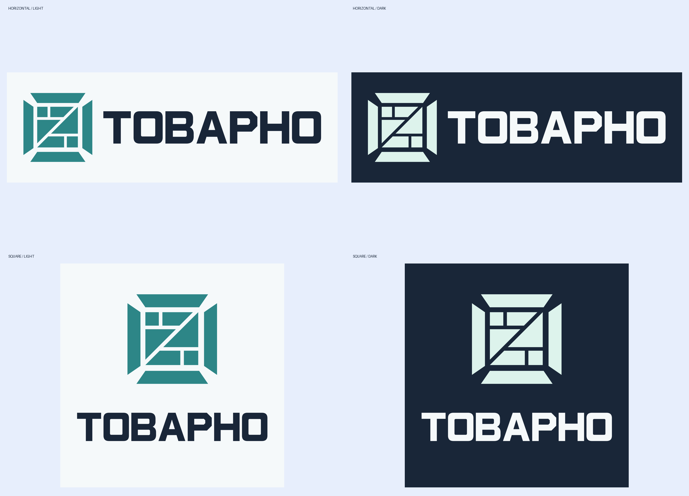

# Брендбук ТОВАРНО

ТОВАРНО — «Товарный бизнес под контролем». Открытая коробка с ячейками учёта образует знак. Надпись собрана из векторных контуров. Её характер задают прямоугольные просветы и диагональные срезы букв.

Исходные мастера и правила хранятся в [бренд-ките](tovarno-brand-kit/). При обновлении айдентики сначала обновите комплект и его палитру, затем проверьте производные материалы.

## Логотип и темы

Выбирайте версию по цвету поверхности непосредственно под логотипом. На светлом фоне используйте чернильную надпись и бирюзовый знак, на тёмном — светлую надпись и мятный знак. Ледяной голубой служит дополнительным фоном.

Оставляйте вокруг внешних границ логотипа свободное поле не меньше половины высоты букв. Рекомендуемая ширина горизонтальной композиции — от 240 px на экране или 50 мм в печати, квадратной — от 160 px или 35 мм. Для меньшей площади используйте отдельный знак шириной от 48 px. Для размеров меньше 48 px понадобится отдельный упрощённый мастер.

Масштабируйте композицию пропорционально. Сохраняйте исходные цвета, ориентацию и положение знака относительно надписи. Для размещения на цветном фоне берите прозрачный SVG. У логотипа нет теней, обводок и градиентов. Для текста интерфейса выбирайте самостоятельную гарнитуру и вставляйте название бренда в логотипе из векторного мастера.

## Палитра sRGB

| Цвет | HEX |
|---|---|
| ink | `#192638` |
| teal | `#2D8687` |
| mint | `#DDF3EC` |
| ice | `#E7EEFC` |
| white | `#F5F9FA` |

[Машиночитаемые значения](tovarno-brand-kit/guidelines/palette.json)

## Применение в Mini App

Для экрана приложения используйте ink и white как пару фона и основного текста, меняя их роли в тёмной теме. Для графиков подходят teal на светлом фоне и mint на тёмном. Проверяйте читаемость подписей и выделение выбранной вкладки на реальном фоне. Полупрозрачность и размытие относятся к поверхности меню. Логотип сохраняет цвета мастера.

## Подготовка материалов

SVG подходит для вёрстки и масштабирования, PNG — для презентаций и быстрых вставок. Значения палитры заданы в sRGB. При печати согласуйте с типографией профиль CMYK и цветопробу. Проверьте минимальный размер на выбранном носителе.

[Готовые композиции](tovarno-brand-kit/svg/) · [Прозрачные композиции](tovarno-brand-kit/svg-transparent/) · [Отдельные знаки](tovarno-brand-kit/symbols/) · [PNG](tovarno-brand-kit/png/)
